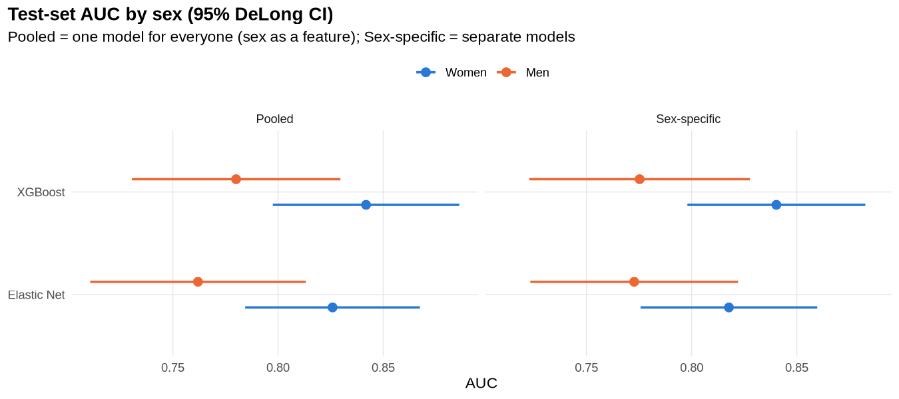
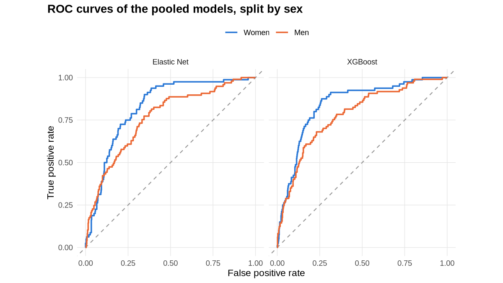
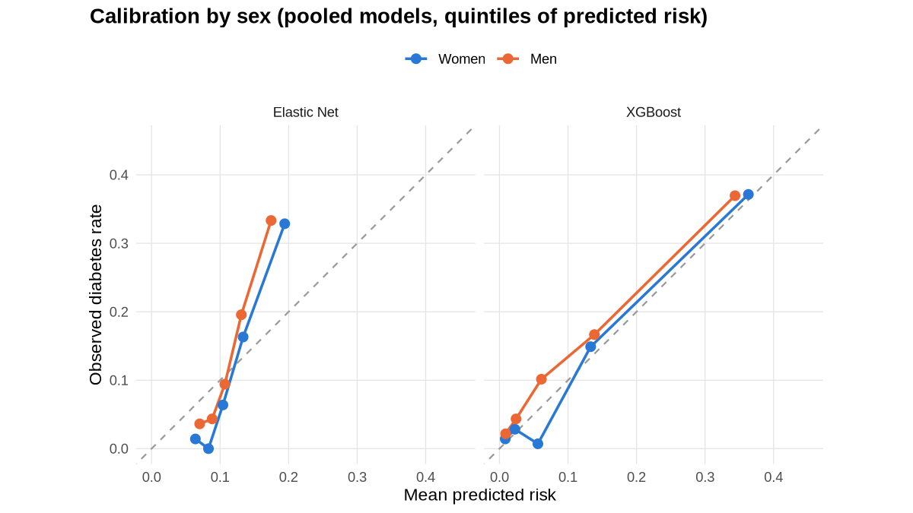
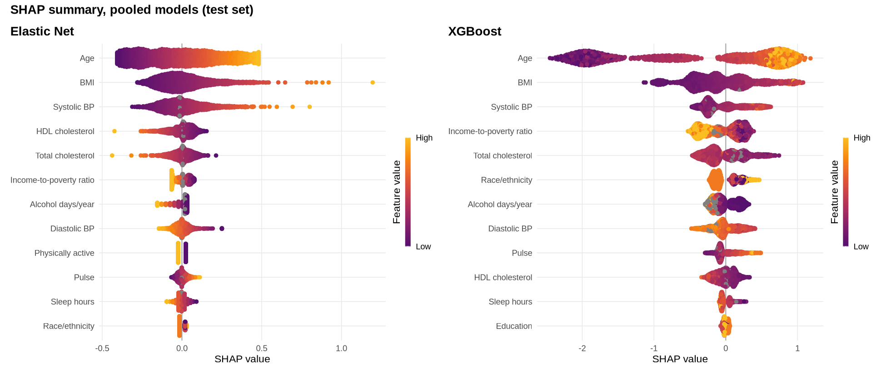
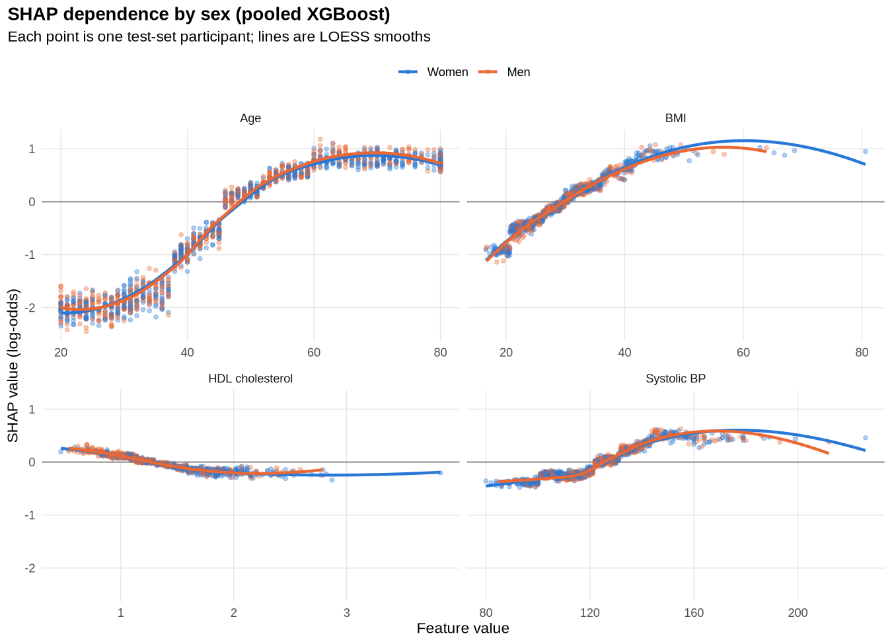
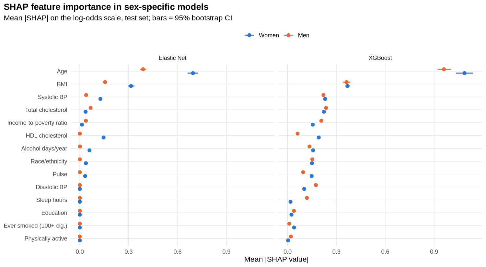
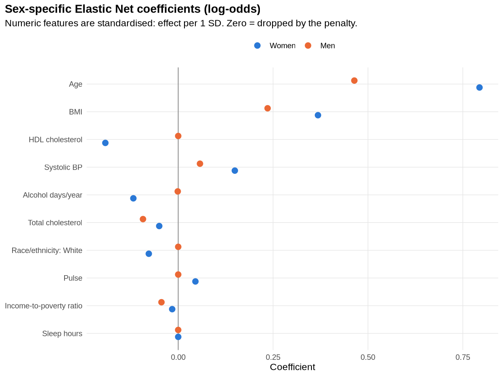

# Diabetes risk in NHANES: Elastic Net vs XGBoost, explained with SHAP, women vs men

A small, fully reproducible R project that predicts **diagnosed diabetes** in US adults
from the public [NHANES](https://cran.r-project.org/package=NHANES) data (2009–2012),
compares a penalised linear model (**Elastic Net**) with a gradient-boosted tree model
(**XGBoost**), explains both with **SHAP**, and asks whether the models behave
differently for **women and men**.

## Questions

1. Do the models discriminate equally well in women and in men?
2. Does training separate models for each sex help, compared with one pooled model?
3. Which risk factors drive predictions, and do they differ between the sexes?

## Data

- Source: the `NHANES` R package (10,000 resampled NHANES 2009–2012 participants).
- Adults aged 20+ with a known diabetes status. The package resamples participants,
  so the same person can appear more than once; **rows are de-duplicated by `ID`**
  to keep anyone from landing in both train and test.
- Final cohort: **4,644** adults (2,389 women, 2,255 men); diabetes prevalence
  11.1% in women and 12.4% in men.
- Features: age, BMI, pulse, systolic/diastolic BP, total and HDL cholesterol,
  income-to-poverty ratio, sleep hours, alcohol days/year, race/ethnicity,
  education, physical activity, smoking history. Lab glucose/HbA1c are not in the
  package and would leak the outcome anyway.

## Methods

| Step | Details |
|---|---|
| Split | 70/30 train/test, stratified by sex × outcome (seed 2026) |
| Pre-processing | Median/mode imputation and standardisation learned on the training set (Elastic Net). XGBoost gets raw values and handles missing values natively |
| Elastic Net | `glmnet`, α ∈ {0, .25, .5, .75, 1} and λ tuned with 10-fold CV (AUC), `lambda.1se` |
| XGBoost | depth 3, η = 0.03, subsample/colsample 0.8; number of rounds by 5-fold CV with early stopping |
| SHAP | Exact TreeSHAP for XGBoost (`predcontrib`); exact linear SHAP, β·(x − E[x]), for Elastic Net. Both on the log-odds scale; one-hot dummies summed back to their variable. Plots with `shapviz` |
| Sex comparison | (a) **Pooled** models with sex as a feature, evaluated separately in women and men; (b) **sex-specific** models trained on each sex alone |
| Evaluation | AUC with DeLong 95% CI, DeLong test women vs men, Brier score, calibration by quintile |

## Results

### Discrimination

| Model | Training | Women AUC (95% CI) | Men AUC (95% CI) |
|---|---|---|---|
| Elastic Net | Pooled | 0.83 (0.78–0.87) | 0.76 (0.71–0.81) |
| Elastic Net | Sex-specific | 0.82 (0.78–0.86) | 0.77 (0.72–0.82) |
| XGBoost | Pooled | 0.84 (0.80–0.89) | 0.78 (0.73–0.83) |
| XGBoost | Sex-specific | 0.84 (0.80–0.88) | 0.78 (0.72–0.83) |

Overall test AUC: Elastic Net 0.79, XGBoost 0.81.



- Both models rank risk **better in women than in men** (≈0.06 AUC gap), but with
  ~80–100 cases per sex in the test set the difference is only borderline
  (DeLong p = 0.058 for Elastic Net, 0.069 for XGBoost).
- **Sex-specific models do not beat the pooled model.** The pooled model barely uses
  the sex variable itself (mean SHAP of `Sex` ≈ ±0.003 log-odds).
- XGBoost is slightly ahead of Elastic Net, with overlapping CIs.




### What drives the predictions



Age and BMI dominate in both models, followed by systolic BP, cholesterol and income.
XGBoost picks up non-linear shapes the linear model cannot: the age effect rises
steeply between 35 and 60 and then flattens, and the BMI effect saturates above ~45.



### Women vs men




In the sex-specific models:

- **Age matters more in women** (mean |SHAP| for Elastic Net 0.70 vs 0.39; XGBoost 1.09 vs 0.96).
- **HDL cholesterol is protective mainly in women**: Elastic Net keeps it for women
  (−0.19 per SD) and drops it for men; XGBoost importance is 0.19 vs 0.06.
- Alcohol days/year has a negative association in women in the linear model; in men
  sleep hours and diastolic BP carry somewhat more weight in XGBoost.

## Caveats

- This is a teaching/demo analysis, not a clinical model. NHANES survey weights and
  design are not used; the `NHANES` package is already resampled to be roughly
  representative.
- "Diabetes" is self-reported diagnosis, so undiagnosed cases count as negatives.
- The bootstrap CIs on SHAP importance resample test rows only and ignore
  model-fitting uncertainty, so they are too narrow for formal inference.
- Elastic Net coefficients across the two sexes are shrunk by different λ values
  (women 0.020, men 0.066), so part of the size difference comes from regularisation.
- The selected α was 0 (ridge) for the pooled model and 0.5 / 0.25 for women / men.

## Reproduce

```bash
conda env create -f environment.yml
conda activate r-nhanes
Rscript -e 'install.packages("NHANES", repos = "https://cloud.r-project.org")'
Rscript run_all.R        # ~20 s; writes outputs/figures and outputs/tables
```

## Layout

```
run_all.R          main pipeline
R/01_data.R        loading, de-duplication, split, pre-processing
R/02_models.R      Elastic Net, XGBoost, evaluation
R/03_plots.R       theme, colours, labels
R/04_shap.R        SHAP for both models, importance with bootstrap CI
outputs/figures/   PNG figures
outputs/tables/    CSV results (performance, coefficients, SHAP importance, ...)
```

---

### خلاصه به فارسی

در این پروژه با داده‌ی عمومی NHANES، دیابت در بزرگسالان با دو مدل Elastic Net و XGBoost
پیش‌بینی و با SHAP تفسیر شده و نتایج بین زنان و مردان مقایسه شده است. هر دو مدل در زنان
بهتر از مردان عمل می‌کنند (AUC حدود ۰٫۸۴ در برابر ۰٫۷۸) ولی این اختلاف از نظر آماری
در مرز معناداری است. آموزش مدل جداگانه برای هر جنس بهبودی نسبت به مدل مشترک نمی‌دهد.
سن و BMI مهم‌ترین عوامل هستند؛ اثر سن و نقش محافظتی HDL در زنان پررنگ‌تر است.
